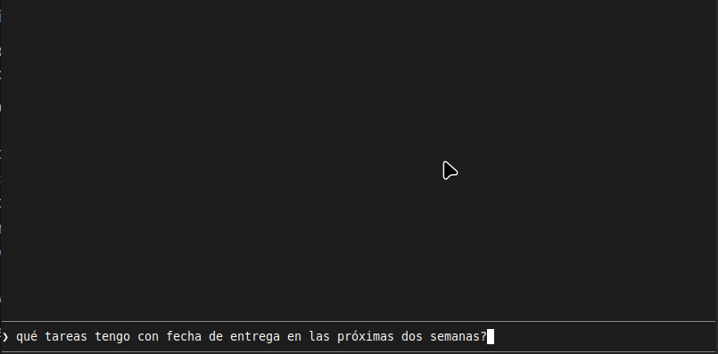

# Moodle MCP (Aula USM)

[](https://github.com/muitomou/moodle-mcp-aula-usm/actions/workflows/tests.yml)


Servidor [MCP (Model Context Protocol)](https://modelcontextprotocol.io) que le da a Claude
u otros asistentes compatibles con MCP acceso a tu Moodle **como estudiante**: ramos, próximas entregas, enunciados de tareas,
materiales, notas, avisos y foros. Así puedes preguntarle cosas como:

> «¿Qué tengo que entregar esta semana?»
> «Léeme el enunciado de la Tarea 2 de Bioinformática y dime qué archivos necesito.»
> «Baja las guías de la unidad 3 de Redes a mi carpeta del ramo.»
> «¿Cómo voy en Inteligencia Artificial?»

Está pensado para **Aula USM** (`https://aula.usm.cl`), pero funciona con cualquier Moodle
que tenga habilitado el servicio de la app móvil oficial (`moodle_mobile_app`).

> Proyecto personal y no oficial: no está afiliado a la USM ni a Moodle HQ.

## Demo

Claude Code consulta las entregas de las próximas dos semanas con `proximas_entregas`:



## Qué puede hacer

| Herramienta | Para qué |
|---|---|
| `listar_ramos` | Ramos vigentes (o todos), con sigla, paralelos y carpeta local |
| `proximas_entregas` | Tareas y actividades con fecha límite, incluidas las atrasadas |
| `ver_tarea` | Enunciado, adjuntos, fechas, formato de entrega y estado de tu entrega |
| `leer_material` | Lee el texto de un PDF o archivo del ramo (y lo guarda en tu carpeta) |
| `contenido_ramo` | Secciones, recursos y archivos de un ramo |
| `descargar_material` | Baja archivos a la carpeta local del ramo |
| `ver_notas` | Nota final por ramo o el detalle de cada evaluación |
| `avisos_y_foros` / `leer_discusion` | Avisos y discusiones de los foros |
| `contactos_ramo` | Profesores y ayudantes (mejor esfuerzo: depende de cómo esté configurado cada ramo) |
| `vincular_carpeta` | Elige qué carpeta local corresponde a cada ramo |

Respecto a Moodle todo es de **solo lectura**. Lo único que escribe es tu disco: las
descargas y el archivo que vincula ramos con carpetas.

## Cómo funciona

```
Claude / cliente MCP ──MCP (stdio)──▶ aula-mcp ──HTTPS + token──▶ API REST de Moodle
                                            │
                                            └──▶ ~/UNIVERSIDAD/<ramo>/Aula/…   (descargas)
```

- Usa la **API REST oficial de Moodle** con el mismo permiso que la app móvil, sin
  *scraping*: las respuestas son estables y no se rompen cuando cambia el diseño del sitio.
- Las respuestas se resumen y se compactan (sin HTML, fechas legibles, sin campos vacíos)
  para gastar pocos tokens: una tarea completa cuesta unos 160 tokens y un enunciado en
  PDF de 4 páginas, unos 3 300.
- Los datos que cambian poco (ramos, contenidos) se guardan en caché por 10 minutos.

## Instalación

La forma más simple es con [uv](https://docs.astral.sh/uv/), que instala `aula-mcp` con
todo lo que necesita (incluido Python, si no lo tienes) y deja sus comandos disponibles en
la terminal. No hace falta clonar el repositorio.

**1. Instala uv** (una sola vez):

En macOS o Linux:

```bash
curl -LsSf https://astral.sh/uv/install.sh | sh
```

En Windows (PowerShell):

```powershell
powershell -ExecutionPolicy ByPass -c "irm https://astral.sh/uv/install.ps1 | iex"
```

**2. Instala aula-mcp:**

```bash
uv tool install git+https://github.com/muitomou/moodle-mcp-aula-usm
```

Si después la terminal no encuentra `aula-mcp-login`, ejecuta `uv tool update-shell` y abre
una terminal nueva. Para actualizar a la última versión: `uv tool upgrade aula-mcp`.

Si prefieres [pipx](https://pipx.pypa.io) (requiere Python 3.10 o superior), también sirve:
`pipx install git+https://github.com/muitomou/moodle-mcp-aula-usm`. Para instalar desde el
código, ve a [Desarrollo](#desarrollo).

## Obtener el token

Aula USM usa inicio de sesión con Microsoft, así que no hay usuario y contraseña que el
programa pueda usar. En su lugar se usa el mismo flujo que la app móvil oficial:

```bash
aula-mcp-login --dir-base ~/Escritorio/UNIVERSIDAD
```

`--dir-base` es opcional: es la carpeta donde tienes una subcarpeta por ramo, para que las
descargas queden ordenadas (ver [Carpetas por ramo](#carpetas-por-ramo)).

1. Se abre Aula en tu navegador. Inicia sesión normalmente.
2. Al terminar, el navegador pregunta si quieres abrir el enlace con otra aplicación
   (*xdg-open*, *Aula MCP Login* o similar). Acepta.
3. Vuelve a la terminal: el programa recibe el enlace, verifica la firma, prueba el token y
   lo guarda en `~/.config/aula-mcp/config.env` (en macOS y Linux, con permisos `600`).

Para que el navegador le entregue el enlace, `aula-mcp-login` registra el comando
`aula-mcp-enlace` como la aplicación que abre los enlaces `moodlemobile://` (los mismos que
usa la app móvil de Moodle). Si otra aplicación ya los abre, no la reemplaza. Para deshacer
el registro: `aula-mcp-login --quitar-enlace`.

<details>
<summary>Si el navegador no pregunta nada (modo a mano)</summary>

Presiona Enter en la terminal, o usa `aula-mcp-login --a-mano` desde el principio:

1. Abre las herramientas de desarrollo del navegador (F12; en Mac, Cmd + Option + I) en la
   pestaña *Consola*.
2. Abre la dirección que muestra la terminal. Moodle intenta abrir la app y la consola
   muestra `Failed to launch 'moodlemobile://token=…'`. Copia esa URL completa.
3. Pégala en la terminal.

</details>

Si ya tienes un token (por ejemplo, en *Preferencias → Claves de seguridad*), usa
`aula-mcp-login --token`.

Para comprobar que todo funciona:

```bash
aula-mcp-check
```

## Conectarlo a Claude

**Claude Code**

```bash
claude mcp add --scope user aula -- aula-mcp
```

**Claude Desktop**: cierra la app por completo, incluso desde la bandeja del sistema, y ejecuta:

```bash
aula-mcp-desktop
```

Este comando agrega el servidor a `claude_desktop_config.json` y respalda el archivo antes.
Luego abre la app. Tiene que estar cerrada porque Claude Desktop reescribe ese archivo
mientras está abierta y borraría el cambio.

**Desde el celular**: el servidor corre en tu computador, porque ahí están el token y tus
carpetas. Con *Remote Control* de Claude Code puedes seguir desde la app de Claude en el
celular una sesión que corre en tu computador, y esa sesión tiene acceso al MCP. Un
conector remoto propio (HTTP + OAuth) está en la hoja de ruta.

## Otros clientes

`aula-mcp` es un servidor MCP estándar que se comunica por stdio, así que funciona con
cualquier cliente que acepte servidores MCP locales. Las aplicaciones de escritorio no
siempre ven los mismos comandos que tu terminal, así que conviene usar la ruta completa:
obtenla con `which aula-mcp` (macOS y Linux) o `where.exe aula-mcp` (Windows) y ponla en
lugar de `/ruta/a/aula-mcp` en los ejemplos. En Windows, escribe la ruta con `/` o con `\\`
dentro del JSON. El token y la configuración se leen de `~/.config/aula-mcp/config.env`,
así que no hace falta repetirlos en cada cliente.

**Cursor**: en `~/.cursor/mcp.json` (global) o `.cursor/mcp.json` (solo un proyecto):

```json
{
  "mcpServers": {
    "aula": {
      "command": "/ruta/a/aula-mcp"
    }
  }
}
```

**VS Code (GitHub Copilot en modo agente)**: en `.vscode/mcp.json` del espacio de trabajo, o
en la configuración de usuario con el comando *MCP: Open User Configuration*. Luego elige el
modo *Agent* en el chat de Copilot:

```json
{
  "servers": {
    "aula": {
      "type": "stdio",
      "command": "/ruta/a/aula-mcp"
    }
  }
}
```

**Gemini CLI**: en `~/.gemini/settings.json` (global) o `.gemini/settings.json` (proyecto):

```json
{
  "mcpServers": {
    "aula": {
      "command": "/ruta/a/aula-mcp"
    }
  }
}
```

**ChatGPT**: la app de ChatGPT solo acepta conectores remotos por HTTP, no servidores locales
por stdio, así que por ahora no se puede conectar. El conector remoto está en la
[hoja de ruta](#hoja-de-ruta).

## Configuración

| Variable | Por defecto | Uso |
|---|---|---|
| `AULA_URL` | `https://aula.usm.cl` | URL de tu Moodle |
| `AULA_TOKEN` | — | Token (lo escribe `aula-mcp-login`) |
| `AULA_DIR_BASE` | — | Carpeta con una subcarpeta por ramo |
| `AULA_CONFIG_DIR` | `~/.config/aula-mcp` | Dónde se guardan `config.env` y `carpetas.json` |

Las variables de entorno tienen prioridad sobre `config.env`.

### Carpetas por ramo

Si `AULA_DIR_BASE` apunta a una carpeta como esta:

```
UNIVERSIDAD/
├── pds/                ← (INF331) Pruebas de Software
├── seminariosisges/    ← (INF363) Seminario de Sistemas y Gestión
├── IA/                 ← (INF295) Inteligencia Artificial
└── 2025-2/             ← semestres pasados (se busca un nivel adentro)
    └── DIU/
```

el MCP reconoce la carpeta de cada ramo por su nombre, su sigla (`INF331`) o abreviaturas
del nombre: `pds` → **P**ruebas **d**e **S**oftware, `seminariosisges` → **Seminario** de
**Sis**temas y **Ges**tión. Cada candidata recibe un puntaje: nombre exacto o sigla >
abreviatura larga > abreviatura corta, y las palabras como «de» o «a» restan. Si una gana
con claridad, la usa y la recuerda; si no, pide elegir con `vincular_carpeta`. **Nunca crea
carpetas por su cuenta.** Los archivos quedan en `<carpeta del ramo>/Aula/<sección>/`.

Las mismas abreviaturas sirven para nombrar ramos: «¿qué tengo pendiente en pds?».

Los nombres que entrega Aula USM, como `(202602)(INF331) PRUEBAS DE SOFTWARE|Paralelos:200`,
se limpian para quedar en sigla, nombre y paralelos.

Para que un ramo dado de baja no aparezca entre los vigentes, ocúltalo en Aula
(*Mis cursos → ⋯ → Quitar de la vista*): `listar_ramos` respeta esa preferencia.

## Seguridad y privacidad

- El token da acceso a tu cuenta de Moodle como lo haría la app móvil: trátalo como una
  contraseña. Vive fuera del repositorio, con permisos `600`, y el token privado que entrega
  Moodle se descarta.
- El token solo se envía al host de `AULA_URL`. Si un enlace de archivo apunta a otro sitio,
  no se descarga.
- Las URLs con token nunca se escriben en los logs.
- Los nombres de archivo que vienen de Moodle se sanean para que no puedan escribir fuera de
  la carpeta del ramo.
- Para revocar el acceso: en Aula, *Preferencias → Claves de seguridad → Reiniciar*.

## Desarrollo

Para trabajar en el código, clónalo e instálalo en un entorno virtual (requiere Python 3.10 o
superior):

```bash
git clone https://github.com/muitomou/moodle-mcp-aula-usm.git
cd moodle-mcp-aula-usm
python3 -m venv .venv
.venv/bin/pip install -e ".[dev]"
.venv/bin/pytest --cov
.venv/bin/ruff check . && .venv/bin/ruff format --check .
```

En Windows, los comandos del entorno quedan en `.venv\Scripts\` en vez de `.venv/bin/`.
Instalado así, `aula-mcp` y los demás comandos viven dentro de `.venv`: usa esas rutas al
configurar Claude u otros clientes.

Los tests usan un Moodle falso, con respuestas en `tests/fixtures/` que siguen el formato de
la API real de Aula USM. No necesitan red ni token. La especificación está en
[SPEC.md](SPEC.md) y la guía para contribuir, en [CONTRIBUTING.md](CONTRIBUTING.md).

## Hoja de ruta

- [ ] Subir entregas (`mod_assign_save_submission`), siempre con confirmación explícita
- [ ] Conector remoto (HTTP + OAuth) para usarlo como conector en la app de Claude y en ChatGPT
- [ ] Publicar en PyPI (`pipx install aula-mcp`)

## English summary

An [MCP](https://modelcontextprotocol.io) server that lets Claude (or any MCP client) read
your Moodle as a student: courses, upcoming deadlines, assignment briefs and attachments,
course files, grades and forum posts. It talks to Moodle's official REST API through the
mobile-app web service (no scraping), works with SSO/Microsoft logins via the mobile launch
flow, keeps responses compact to save tokens, and is read-only towards Moodle. Built for
Aula USM (Universidad Técnica Federico Santa María, Chile) but usable with any Moodle that
enables the mobile web service.
Install it with `uv tool install git+https://github.com/muitomou/moodle-mcp-aula-usm`.

## Cambios

Ver [CHANGELOG.md](CHANGELOG.md).

## Licencia

[MIT](LICENSE)
